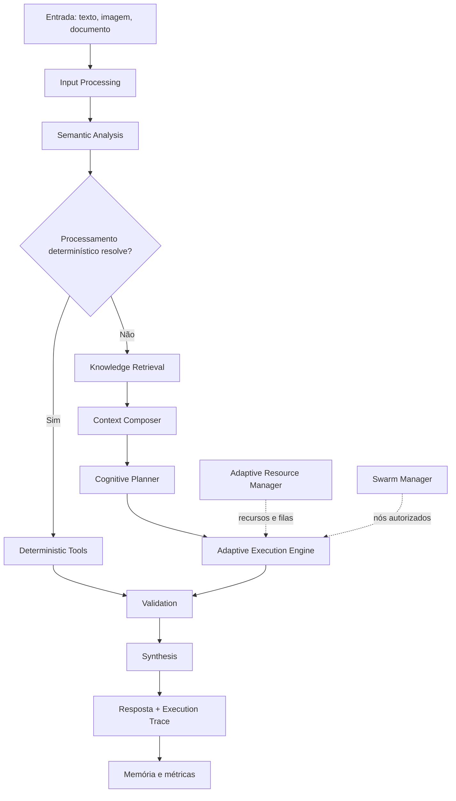

# AILocal Universal

> **Plataforma cognitiva local, adaptativa e distribuída.**  
> Uma arquitetura que coordena modelos de linguagem, ferramentas determinísticas, conhecimento local e recursos computacionais para resolver tarefas com eficiência, rastreabilidade e controle.

**Status:** em fundação — arquitetura e contratos iniciais em construção  
**Plataforma prioritária:** Linux (com foco inicial em Arch Linux)  
**Interface prevista:** Python + PySide6  
**Primeiro backend de inferência:** Ollama

---

## Visão

O AILocal Universal pretende ir além de um chat conectado a um modelo local. Será uma plataforma modular que recebe uma tarefa, identifica o que é necessário para resolvê-la, escolhe ferramentas e modelos compatíveis, recupera conhecimento quando pertinente, acompanha a execução e verifica o resultado.

O princípio central é **usar o mecanismo mais adequado para cada parte da tarefa — e não usar um LLM para tudo**.

Cálculos, parsing, conversões, consultas estruturadas e testes devem ser executados por ferramentas determinísticas sempre que possível. Modelos de linguagem entram quando interpretação semântica, planejamento, geração ou síntese agregam valor.

A execução será local por padrão. Em uma etapa posterior, computadores autorizados poderão cooperar em tarefas distribuíveis, compartilhamento de arquivos e sincronização de conhecimento.

## Objetivos

- **Orquestração cognitiva:** decompor solicitações em etapas e selecionar estratégias de execução.
- **Independência de backend:** manter o núcleo desacoplado do Ollama e permitir outros motores.
- **Eficiência de recursos:** considerar RAM, VRAM, CPU, GPU, carregamento, filas e latência.
- **Conhecimento verificável:** recuperar documentos e preservar a origem das evidências.
- **Execução adaptativa:** escolher ferramentas, modelos e nós conforme a tarefa e os recursos.
- **Distribuição segura:** permitir cooperação entre máquinas sem presumir memória ou GPU compartilhada.
- **Rastreabilidade:** registrar decisões, tempos, recursos e resultados para diagnóstico.

## Arquitetura em uma visão



O fluxo é adaptativo: tarefas simples podem seguir caminhos curtos e não precisam atravessar todas as etapas.

### Camadas principais

| Camada | Responsabilidade |
|---|---|
| Input Processing | Receber entradas e anexos, preservando o conteúdo original |
| Semantic Analysis | Estimar intenção, capacidades, dificuldade, incerteza, risco e urgência |
| Deterministic Processing | Executar cálculos, parsers, consultas e verificações por código |
| Knowledge Retrieval | Recuperar documentos, trechos e evidências |
| Context Composer | Selecionar e organizar contexto com proveniência |
| Cognitive Planner | Decompor tarefas e definir dependências |
| Adaptive Execution Engine | Selecionar motor, modelo, ferramenta ou nó |
| Validation | Verificar cálculos, evidências, restrições e saídas |
| Synthesis | Produzir a resposta final quando geração linguística for necessária |
| Memory and Trace | Registrar histórico, métricas e rastros de execução |

Serviços transversais: **Adaptive Resource Manager**, **Model Manager**, **Knowledge Manager**, **Swarm Manager**, **Telemetry** e **Storage**.

## Núcleo cognitivo

### CognitiveTask

É o contrato intermediário padronizado entre as camadas. Reúne a entrada original, análise, evidências, plano, limites de recursos, rastros e resultado. O contrato terá versão para permitir evolução compatível.

Campos planejados incluem:

- Identidade da tarefa e versão do esquema.
- Texto original, texto normalizado e anexos.
- Intenção e capacidades necessárias.
- Dificuldade, incerteza, risco e urgência.
- Resultados determinísticos e evidências.
- Plano de execução e subtarefas.
- Orçamento de tokens, memória e prazo.
- Rastro de execução e resultado.

Pontuações serão indicadores até que sejam calibradas com dados de avaliação; não serão tratadas como probabilidades confiáveis por padrão.

### Capability Vectorizer

A primeira taxonomia terá 12 dimensões:

| Dimensão | Capacidade |
|---|---|
| D0 | Conversa geral |
| D1 | Programação |
| D2 | Matemática e lógica |
| D3 | Ciências e conhecimento |
| D4 | RAG e memória externa |
| D5 | Visão e multimodalidade |
| D6 | Escrita e criatividade |
| D7 | Pesquisa externa |
| D8 | Ferramentas |
| D9 | Planejamento |
| D10 | Verificação |
| D11 | Interdisciplinaridade |

A implementação inicial combinará embeddings, âncoras semânticas e regras multilabel. Dificuldade, risco, incerteza e urgência serão avaliados separadamente.

## Motores de execução

O núcleo utilizará um contrato comum de engine adapter para consultar disponibilidade e capacidades, listar modelos, estimar recursos, executar tarefas, transmitir resultados, cancelar operações e descarregar modelos.

| Motor | Papel | Estado |
|---|---|---|
| Ollama | Primeiro backend local | Prioridade da Fase 1 |
| llama.cpp | Backend alternativo | Planejado |
| BitNet | Inferência experimental | Laboratório |
| Remote Engine | Execução em nó autorizado | Planejado |
| Specialist Engines | Motores especializados | Evolução futura |

O modo manual deverá respeitar a escolha explícita do usuário. O modo automático permitirá que o Orchestrator selecione ferramentas e motores compatíveis.

## Gerenciamento de recursos

O **Adaptive Resource Manager** deverá observar RAM, VRAM, CPU, GPU, pressão de memória, carregamento de modelos, filas, cache e concorrência.

A estimativa de execução considerará, no mínimo:

**T previsto = tempo de fila + carregamento + transferência + execução.**

O orçamento de memória deverá incluir pesos, cache KV, contexto, buffers e sobrecarga do runtime. Paginação em SSD não será tratada como substituta de RAM/VRAM para inferência interativa.

## Conhecimento e RAG

A camada de conhecimento será composta por carregadores de documentos, parsers, chunker, embeddings, armazenamento vetorial, busca híbrida, reranking e composição de contexto.

Toda evidência deverá preservar sua proveniência: documento, trecho, página ou localização, metadados, data de ingestão e hash do conteúdo. A compressão de contexto deverá preservar negações, números, unidades, condições, exceções e referências.

## Swarm P2P

A evolução distribuída será separada em três planos:

1. **Control Plane:** descoberta, identidade, heartbeat, telemetria e inventário de capacidades.
2. **Data Plane:** transferência autenticada de tarefas, resultados, arquivos e conhecimento.
3. **Execution Plane:** despacho de subtarefas, especialistas remotos e Map-Reduce.

O primeiro caso de uso será a distribuição de tarefas independentes e a sincronização de conhecimento.

Descoberta na rede não concede autorização. Pareamento entre nós, autenticação, criptografia de transporte, limites de recursos, cancelamento e verificação SHA-256 serão requisitos. Inferência distribuída por camadas e RPC permanecerão experimentais: rede não equivale a memória compartilhada, e latência pode superar o benefício.

## Interface prevista

- **Chat:** conversas, streaming e seleção manual/automática de modelo.
- **Modelos:** inventário, capacidades, carregamento e estado.
- **Pipeline:** etapas, decisões e execution traces.
- **Conhecimento:** documentos, indexação, busca e fontes.
- **Rede:** nós autorizados, telemetria e tarefas distribuídas.
- **Diagnóstico:** RAM/VRAM, CPU/GPU, latências e benchmarks.

A interface deverá continuar acessível mesmo quando um backend estiver indisponível.

## Estrutura do repositório

```text
AILocalUniversal/
├── README.md
├── pyproject.toml
├── requirements.txt
├── install.sh
├── .gitignore
├── CONTRIBUTING.md
├── docs/
│   ├── ARCHITECTURE.md
│   ├── ROADMAP.md
│   ├── SECURITY.md
│   └── DATA_CONTRACTS.md
├── app/
│   ├── main.py
│   ├── main_window.py
│   └── views/
├── core/
│   ├── cognitive_task.py
│   ├── orchestrator.py
│   ├── task_router.py
│   ├── capability_vectorizer.py
│   └── execution_trace.py
├── pipeline/
├── engines/
├── resources/
├── knowledge/
├── swarm/
├── storage/
├── tests/
│   ├── unit/
│   ├── integration/
│   ├── network/
│   └── benchmarks/
└── scripts/
```

A árvore será preenchida incrementalmente. Diretórios podem ganhar submódulos à medida que existirem implementações e testes correspondentes.

## Plano de desenvolvimento

| Fase | Entrega |
|---|---|
| 0 — Fundação | Documentação, contratos, padrões, testes e empacotamento |
| 1 — Aplicação base | PySide6, histórico, configurações, Engine Adapter e Ollama |
| 2 — Núcleo cognitivo | CognitiveTask, análise semântica, ferramentas determinísticas e Orchestrator |
| 3 — Conhecimento | RAG, Context Composer, memória e validação |
| 4 — Recursos | Monitoramento, Model Manager, filas e seleção adaptativa |
| 5 — Rede cooperativa | Node Agent, descoberta, protocolo seguro e Map-Reduce |
| 6 — Laboratório | BitNet, RPC, speculative decoding e experimentos multi-host |

**Diretriz:** primeiro um sistema local confiável; depois adaptativo; por último, distribuído. Cada fase deverá demonstrar funcionamento por testes e métricas antes de ampliar a complexidade.

## Benchmark e critérios de qualidade

Os benchmarks separarão modelo frio de modelo já carregado e registrarão:

- Tempo até o primeiro token e tokens/s.
- Latência total e tempo por etapa.
- Tempo de carregamento.
- Pico de RAM/VRAM e uso de CPU/GPU.
- Bytes transferidos e custo de coordenação.
- Qualidade da tarefa, precisão e cobertura de evidências.
- Falhas, timeouts e cancelamentos.

Cenários mínimos: pergunta simples, operação matemática, lógica, análise de código, RAG documental, planejamento complexo e Map-Reduce multi-host.

Nenhuma melhoria de desempenho será declarada sem benchmark reproduzível e avaliação de qualidade.

## Segurança e privacidade

- Processamento local por padrão.
- Menor privilégio e autorização explícita para nós remotos.
- Transporte criptografado e autenticação entre nós.
- Limites de tempo, memória e concorrência.
- Isolamento de tarefas remotas e proibição de comandos arbitrários por padrão.
- Integridade de arquivos por hash.
- Logs sem credenciais ou segredos.
- Cancelamento e tratamento de falhas.
- Separação entre resultados determinísticos, evidências recuperadas e conteúdo gerado por modelos.

Consulte [docs/SECURITY.md](docs/SECURITY.md) antes de habilitar funcionalidades de rede.

## Estado atual

Este repositório está sendo inicializado. A documentação descreve a arquitetura-alvo; ela **não significa que todos os componentes estejam implementados**. O trabalho será acompanhado por fases, testes e registros explícitos de funcionalidades disponíveis, planejadas ou experimentais.

## Como contribuir

Leia [CONTRIBUTING.md](CONTRIBUTING.md), a [arquitetura](docs/ARCHITECTURE.md), o [roadmap](docs/ROADMAP.md) e os [contratos de dados](docs/DATA_CONTRACTS.md). Mudanças devem incluir testes adequados e não devem introduzir promessas de desempenho sem medição.

---

**AILocal Universal — inteligência local coordenada por software, ferramentas e recursos reais.**

## Licença e propriedade intelectual

O código e os materiais originais do AILocal Universal são proprietários e reservados ao titular identificado como `K410Sh4`. Consulte [LICENSE](LICENSE), [NOTICE.md](NOTICE.md), [política de licenciamento](docs/LICENSING.md) e [registro de ativos originais](docs/PROJECT_IP_REGISTER.md).

Bibliotecas, frameworks, motores, modelos, pesos, datasets e conteúdo de terceiros não são relicenciados por este projeto. Consulte [THIRD_PARTY_NOTICES.md](THIRD_PARTY_NOTICES.md) antes de distribuir ou integrar componentes.
