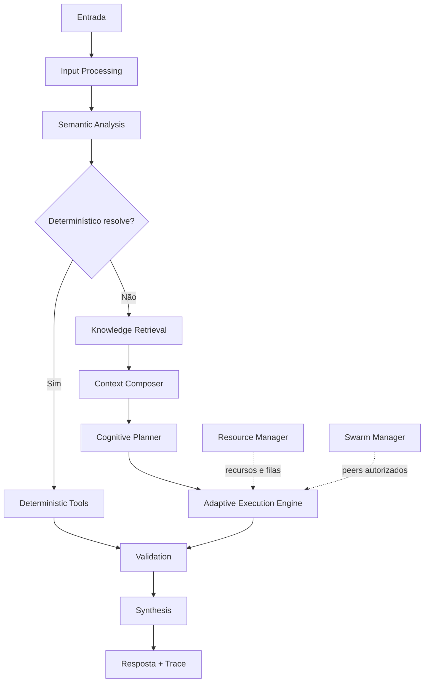

# AILocal Universal

> **Plataforma cognitiva local, adaptativa e distribuída.**

O AILocal Universal coordena modelos de linguagem, ferramentas determinísticas, conhecimento local e recursos computacionais. Seu princípio central é usar o mecanismo mais adequado para cada parte da tarefa — não acionar um LLM para tudo.

**Estado:** fundação inicial; componentes estão sendo implementados por fases.  
**Plataforma prioritária:** Linux / Arch Linux.  
**Interface:** Python + PySide6.  
**Primeiro backend planejado:** Ollama.

## Visão

O sistema recebe uma solicitação, identifica as capacidades necessárias, escolhe ferramentas e motores compatíveis, recupera conhecimento quando pertinente, acompanha a execução e valida resultados. O processamento será local por padrão. A cooperação entre computadores autorizados virá em uma etapa posterior.

## Objetivos

- Orquestração cognitiva e decomposição de tarefas.
- Independência de backend de inferência.
- Uso consciente de RAM, VRAM, CPU, GPU e latência.
- Ferramentas determinísticas antes de LLM quando apropriado.
- RAG com proveniência e evidências rastreáveis.
- Execução adaptativa e, futuramente, distribuição segura entre nós.
- Traces, métricas e benchmarks reproduzíveis.

## Pipeline conceitual



Tarefas simples podem seguir caminhos curtos. O pipeline não obriga cada solicitação a atravessar todas as etapas.

## Componentes

| Componente | Responsabilidade |
|---|---|
| CognitiveTask | Contrato versionado entre camadas |
| Capability Vectorizer | Representar as capacidades requeridas |
| Orchestrator | Coordenar etapas e dependências |
| Deterministic Tools | Cálculos, parsers, consultas e validações |
| Knowledge / RAG | Ingestão, indexação e recuperação de evidências |
| Context Composer | Montar contexto sem perder proveniência |
| Adaptive Execution Engine | Selecionar ferramentas e motores |
| Resource Manager | Observar recursos e controlar concorrência |
| Swarm Manager | Coordenar tarefas entre nós autorizados |
| Validation | Verificar resultados e restrições |
| Execution Trace | Registrar decisões, etapas e métricas |

### Capability Vectorizer

Taxonomia inicial: conversa geral, programação, matemática/lógica, ciências/conhecimento, RAG/memória, visão, escrita/criatividade, pesquisa externa, ferramentas, planejamento, verificação e interdisciplinaridade. Dificuldade, risco, incerteza e urgência serão avaliados separadamente. Scores não serão tratados como probabilidades calibradas sem validação.

## Execução e modelos

O núcleo terá um contrato comum de Engine Adapter. Ollama é o primeiro backend planejado; llama.cpp, BitNet e Remote Engine são extensões futuras. O modo manual respeitará o modelo escolhido; o automático permitirá seleção pelo Orchestrator.

A estimativa de execução considerará fila, carregamento, transferência e computação. O orçamento de memória deverá considerar pesos, cache KV, contexto, buffers e sobrecarga do runtime. SSD/swap não será tratado como extensão prática de RAM/VRAM para inferência interativa.

## Conhecimento e RAG

Document loaders, parsers, chunking, embeddings, busca híbrida, reranking e composição de contexto. Evidências preservarão origem, trecho, página/localização, metadados e hash. Negações, números, unidades, condições e exceções deverão ser preservados.

## Swarm P2P

Separação em Control Plane (descoberta e telemetria), Data Plane (tarefas, resultados e arquivos com autenticação/criptografia) e Execution Plane (despacho e Map-Reduce). O primeiro caso de uso será distribuir tarefas independentes e sincronizar conhecimento.

Descobrir um peer não concede autorização. RPC e inferência distribuída por camadas serão experimentais: rede não equivale a memória compartilhada, e latência pode superar o benefício.

## Estrutura

```text
app/          Interface PySide6
core/         CognitiveTask, Orchestrator e contratos
pipeline/     Etapas cognitivas
engines/      Adaptadores de inferência
resources/    Monitoramento e gerenciamento de recursos
knowledge/    Ingestão, indexação e RAG
swarm/        Nós e execução distribuída
storage/      Configurações e persistência
docs/         Arquitetura, roadmap, segurança e contratos
tests/        Testes unitários, integração e rede
scripts/      Diagnóstico e benchmarks
```

## Instalação e execução

Requer Python 3.11 ou superior.

```bash
./install.sh
.venv/bin/ailocal
```

Para executar os testes:

```bash
.venv/bin/python -m pytest
```

Para verificar estilo:

```bash
.venv/bin/ruff check .
```

## Roadmap

| Fase | Entrega |
|---|---|
| 0 | Fundação, documentação, contratos e testes |
| 1 | Aplicação PySide6, histórico e integração Ollama |
| 2 | Núcleo cognitivo e ferramentas determinísticas |
| 3 | RAG, contexto e validação |
| 4 | Gerenciamento adaptativo de recursos |
| 5 | Rede cooperativa, segurança e Map-Reduce |
| 6 | Laboratório BitNet, RPC e otimizações |

## Benchmarks

Medir tempo até primeiro token, tokens/s, latência total, carregamento, pico RAM/VRAM, CPU/GPU, bytes transferidos, qualidade, cobertura de evidências e falhas. Separar modelos frios e quentes. Nenhuma melhoria será declarada sem benchmark reproduzível.

## Segurança

Local-first, menor privilégio, autorização explícita dos peers, transporte criptografado, limites de recursos, cancelamento, integridade SHA-256 e logs sem segredos. Conteúdo recuperado deve ser tratado como dado não confiável.

## Documentação

- [Arquitetura](docs/ARCHITECTURE.md)
- [Roadmap](docs/ROADMAP.md)
- [Segurança](docs/SECURITY.md)
- [Contratos de dados](docs/DATA_CONTRACTS.md)
- [Contribuição](CONTRIBUTING.md)

> **Importante:** este repositório está em fundação. O README descreve a arquitetura-alvo e não afirma que todos os componentes estejam implementados.
