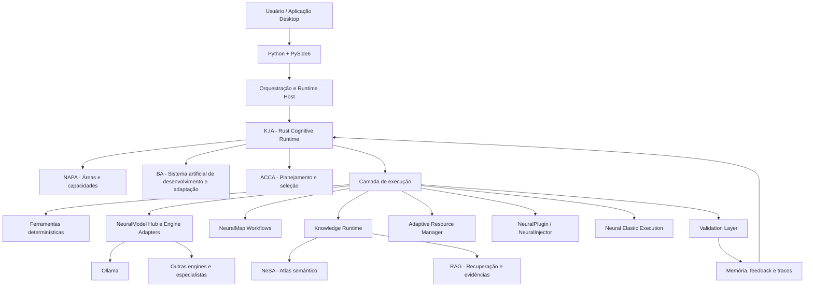

# AILocal Universal

> **Plataforma cognitiva local, adaptativa, modular e extensível.**

O **AILocal Universal (AILU)** é uma plataforma para coordenar modelos de IA locais, ferramentas determinísticas, conhecimento privado, workflows e recursos computacionais. Seu princípio central é selecionar o mecanismo adequado para cada parte de uma tarefa — em vez de encaminhar tudo obrigatoriamente a um único modelo de linguagem.

O projeto combina uma aplicação desktop em Python/PySide6, runtimes e componentes de alto desempenho em Rust, engines de inferência intercambiáveis e uma arquitetura cognitiva adaptativa em evolução.

> **Estado desta linha de integração:** consolidação em andamento na branch `integration/unified-architecture-v1`. Esta documentação descreve a arquitetura pretendida e diferencia recursos implementados, experimentais e planejados. A PR de integração permanece em Draft; a `main` não deve ser considerada atualizada até a revisão e o merge.

- **Plataforma prioritária:** Linux, especialmente Arch Linux.
- **Interface:** Python + PySide6.
- **Runtime cognitivo:** Rust.
- **Engine inicial:** Ollama, por adaptador.
- **Armazenamento local:** JSON e SQLite, conforme o subsistema.
- **Princípios:** local-first, modularidade, contratos explícitos, segurança por padrão, rastreabilidade e validação empírica.

---

## 1. Visão geral da arquitetura

O AILU não é um único modelo nem pretende substituir todos os modelos existentes. É uma plataforma de coordenação que combina capacidades cognitivas, ferramentas, conhecimento, workflows e especialistas externos.

### 1.1. Arquitetura em camadas



O diagrama representa a arquitetura de referência. Nem todas as conexões e capacidades estão implementadas ou habilitadas nesta etapa.

### 1.2. Responsabilidades por camada

| Camada | Responsabilidade |
|---|---|
| Interface e aplicação | Chat, configurações, modelos, conhecimento, inspeção e workflows |
| Cognitive Core | Normalização, análise de intenção, decomposição e ferramentas determinísticas |
| K.IA Runtime | Planejamento cognitivo, seleção de componentes, contratos e feedback |
| BA | Sistema artificial distinto de IA convencional: desenvolvimento estrutural, especialização regional, adaptação ambiental e evolução controlada; em pesquisa conceitual/experimental |
| ACCA | Formalização da seleção adaptativa, custos, orçamento e estratégia de execução |
| NAPA | Registro e classificação multilabel de áreas cognitivas |
| Knowledge Runtime | Coordenação de recuperação documental e evidências |
| RAG | Ingestão, indexação, recuperação híbrida e composição de contexto |
| NeSA | Catálogo semântico e navegação por páginas documentais |
| NeuralModel Hub | Catálogo, descoberta, metadados e compatibilidade de modelos |
| Adaptive Resource Manager | Estimativa de recursos e seleção condicionada ao hardware |
| NeuralMap | Editor visual e runtime de workflows declarativos |
| NeuralPlugin | Gerenciamento de especializações e plugins |
| NeuralInjector | Formato `.neuralinjector` e importação/exportação de grafos; instalação de plugins e ativação de componentes ainda pendentes |
| Neural Elastic Execution | Pesquisa e simulação de políticas de cache para especialistas |
| Validation Layer | Verificação estrutural, replay determinístico e integridade de evidências |
| Swarm | Arquitetura futura de cooperação entre máquinas |

---

## 2. K.IA — Artificial Brain / Rust Cognitive Runtime

A **K.IA** é o núcleo de coordenação cognitiva do AILU. Ela não é um LLM isolado: é um runtime que representa capacidades e componentes, planeja rotas e coordena executores registrados.

### 2.1. Responsabilidades

- Manter uma rede tipada de capacidades, componentes e conexões.
- Avaliar intenção, contexto, prioridades e disponibilidade.
- Selecionar componentes compatíveis com a tarefa.
- Respeitar orçamento lógico de recursos e requisitos declarados.
- Produzir planos de execução rastreáveis.
- Receber feedback avaliado e atualizar prioridades operacionais.
- Persistir o estado cognitivo permitido, sem armazenar automaticamente prompts ou respostas como memória da rede.
- Comunicar-se com a aplicação Python por protocolo local versionado.

### 2.2. Evolução do runtime

| Versão | Escopo |
|---|---|
| K.IA 0.1 | Crate Rust, contratos tipados, rede de capacidades, planner, executores registrados e plasticidade operacional inicial |
| K.IA 0.2 | Processo persistente `kia-runtime-host`, protocolo JSONL e ponte Python |
| K.IA 0.3 | Fluxo ACCA integrado ao Chat, NAPA, ferramentas, Ollama e Validation Layer |
| K.IA 0.4 | Snapshot SQLite, restauração validada, event log e integração Knowledge/NeSA |
| K.IA 0.5 | Incrementos de segurança de execução, cancelamento, deadlines e leases de recursos |

As versões representam incrementos da linha de desenvolvimento. A presença de uma versão no histórico não significa que todos os recursos estejam validados operacionalmente em qualquer hardware.

### 2.3. Limites atuais

O runtime coordena executores por contratos; não modifica automaticamente os pesos internos de modelos como Qwen ou Gemma. A plasticidade implementada é operacional, baseada em feedback e prioridades de conexões. Ela não equivale a treinamento neural geral.

A estimativa de orçamento também não é, por si só, um limitador do kernel, da GPU ou do consumo físico. Telemetria e controle efetivo precisam ser confirmados pelos adaptadores e pelo sistema operacional.

Documentação: [K.IA Architecture](docs/KIA_ARCHITECTURE.md), [Runtime Host Protocol](docs/KIA_RUNTIME_HOST_PROTOCOL.md), [Cognitive Memory](docs/KIA_COGNITIVE_MEMORY.md).

---

## 3. BA — Brain Artificial

A **Brain Artificial (BA)** é uma linha de desenvolvimento própria e conceitualmente distinta de Inteligência Artificial convencional. Não deve ser definida como LLM, Transformer, modelo generativo, roteador de modelos ou simples rede neural treinada por gradiente.

A BA é pesquisada como um **sistema artificial de organização, desenvolvimento, adaptação e evolução**, inspirado em princípios estruturais dos organismos vivos: diferenciação regional, nichos ambientais, homeostase, comunicação local, especialização, plasticidade, diversidade, seleção e desenvolvimento ao longo do tempo.

A distinção arquitetural é obrigatória:
- **BA:** sistema em desenvolvimento, com organização e adaptação próprias.
- **K.IA:** runtime de coordenação e execução do AILU.
- **Modelos de IA externos:** ferramentas opcionais que podem auxiliar tarefas específicas, sem definir a natureza ou a estrutura interna da BA.

A BA não será reduzida a um conjunto de modelos de IA conectados. Sua arquitetura deverá ser validada por mecanismos próprios, estados próprios, ciclos de desenvolvimento e experimentos ambientais controlados. O uso futuro de modelos externos não altera essa separação.

A intenção é desenvolver uma estrutura hierárquica de regiões, sub-regiões e unidades, com conexões locais e de longa distância, na qual especializações surjam e se modifiquem em resposta aos ambientes e às interações. A K.IA poderá hospedar ou coordenar componentes da BA, mas não é sinônimo dela.

### 3.1. Modelo conceitual

```text
BA/
├── cognitive_regions/
│   ├── mathematics/
│   │   ├── subregions/
│   │   └── units/
│   ├── programming/
│   │   ├── subregions/
│   │   └── units/
│   ├── reasoning/
│   │   ├── subregions/
│   │   └── units/
│   └── language/
│       ├── subregions/
│       └── units/
├── connection_graph/
├── activation/
├── plasticity/
├── specialists/
├── persistent_memory/
├── cache/
└── evaluation/
```

Esta é uma organização lógica proposta, não a afirmação de que cada unidade já seja um neurônio artificial treinável ou que exista uma implementação física completa da BA.

### 3.2. Desenvolvimento ambiental e comunicação regional

A pesquisa NeuralDNA/NeuralStem investiga hereditariedade artificial, desenvolvimento, diferenciação regional, avaliação ambiental e linhagens. Os benchmarks 0.5–0.7 avaliam antecipação, nichos regionais e comunicação espacial. Esses experimentos são isolados e não equivalem ainda à BA operacional.

A hipótese estrutural é que regiões devem manter autonomia quando seus nichos divergem e compartilhar sinais quando há benefício preditivo demonstrável. Topologia, distância, atraso, perda e custo de comunicação devem influenciar a especialização, em vez de impor conectividade global uniforme.

Documentação experimental: [NeuralDNA 0.7 — Spatial Communication](docs/NEURALDNA_SPATIAL_COMMUNICATION_V0.7.md).


### 3.4. Ativação seletiva e armazenamento hierárquico

A direção de pesquisa é manter dados persistentes em SSD/HDD, estruturas frequentes em RAM e componentes necessários à execução em VRAM, com cache e prefetch controlados pelo runtime.

Armazenamento em disco não equivale a memória de GPU: latência, largura de banda, PCIe, RAM e VRAM impõem limites físicos. A arquitetura deverá ser validada com medições reais de I/O, carregamento, cache e execução.

### 3.5. Plasticidade

A plasticidade própria da BA deverá distinguir:
- **Plasticidade estrutural:** formação, fortalecimento, enfraquecimento e remoção controlada de conexões.
- **Regulação funcional:** alteração reversível da atividade e da expressão de capacidades conforme o nicho.
- **Diferenciação:** especialização progressiva de regiões e unidades conforme desenvolvimento e demanda.
- **Homeostase:** manutenção de estabilidade interna, limites de recursos e equilíbrio populacional.
- **Herança e evolução:** transmissão de características apenas por ciclos hereditários explicitamente definidos, com proveniência e avaliação de descendência.

Treinamento de LLMs, LoRA/DoRA e transformação de pesos pertencem ao ecossistema de modelos externos do AILU; não definem a plasticidade nem a evolução próprias da BA.

Cada mecanismo deverá possuir avaliação, limites, versionamento, rastreabilidade e possibilidade de rollback.

---

## 4. ACCA — Adaptive Cognitive Computation Architecture

A **ACCA** formaliza como selecionar uma estratégia de processamento considerando qualidade esperada, tempo, energia, risco, recursos e requisitos da tarefa.

Uma formulação de referência para comparar estratégias candidatas é:

```math
a^* = \arg\max_{a \in A(q)}
\left[
\widehat{Q}(a)
- \lambda_t T(a)
- \lambda_e E(a)
- \lambda_r R(a)
\right]
```

Onde:
- `Q`: qualidade esperada ou medida.
- `T`: tempo/latência.
- `E`: custo energético ou computacional.
- `R`: risco e penalidades operacionais.
- `λ`: pesos de importância configuráveis ou calibrados.

A seleção deve respeitar restrições obrigatórias, como capacidades, permissões, memória, hardware, disponibilidade de executores e orçamento.

**Estado:** há formalização matemática e um planner Rust com sinais heurísticos e orçamento lógico. Os pesos atuais não devem ser tratados como parâmetros treinados ou probabilidades calibradas. Calibração e comparação experimental permanecem necessárias.

A ACCA não substitui a atenção interna de Transformers. Ela opera em nível de coordenação: decide quando e como utilizar modelos, ferramentas, conhecimento e especialistas.

Documentação: [ACCA Mathematical Model](docs/ACCA_MATHEMATICAL_MODEL.md).

---

## 5. NAPA — Neural Adaptive Plasticity Architecture

A NAPA organiza a classificação e o registro de áreas cognitivas ativadas por uma solicitação. Uma tarefa pode envolver várias áreas simultaneamente.

Áreas iniciais incluem:
- Matemática e conversão.
- Comunicação e cordialidade social.
- Raciocínio e opinião.
- Criatividade e geração.
- Programação.
- Conhecimento e recuperação.
- Percepção e uso de ferramentas.

NAPA 1.0 possui registro de áreas e classificação multilabel com sinais explicáveis. Suas afinidades são heurísticas, não probabilidades calibradas.

NAPA não é, isoladamente, um roteador de modelos, um sistema de treinamento ou um conjunto de LLMs independentes. Ela fornece sinais para o planejamento da K.IA/ACCA.

Documentação: [NAPA](docs/NAPA.md).

---

## 6. Conhecimento local: RAG e NeSA

### 6.1. RAG — Retrieval-Augmented Generation

O subsistema de conhecimento permite indexar documentos localmente e fornecer evidências ao fluxo cognitivo.

Capacidades existentes na linha de desenvolvimento:
- Loaders explícitos para TXT, Markdown e PDF com extração local.
- Proveniência por SHA-256, URI, página, seção e offsets.
- Chunking com limites e sobreposição.
- Índice lexical SQLite FTS5.
- Embeddings por endpoint Ollama `/api/embed`.
- Armazenamento vetorial SQLite.
- Recuperação lexical e vetorial combinada por Reciprocal Rank Fusion (RRF).
- Context Composer, referências e Evidence Validator.
- Integração opcional ao Chat e ferramentas de teste/benchmark.

Documentos recuperados são dados não confiáveis. Integridade de hash e referência de origem não provam que uma alegação gerada seja verdadeira ou logicamente sustentada pela fonte.

### 6.2. NeSA — Neural Semantic Atlas

A NeSA complementa o RAG com um catálogo de páginas documentais. A versão inicial produz fichas por página com metadados de origem, resumo extrativo, palavras-chave e candidatos lexicais a conceitos, indexados para busca.

NeSA não substitui a recuperação de chunks originais nem a validação de evidências. Grafo semântico, embeddings de páginas e relações factuais são evoluções futuras, não capacidades presumidas da versão inicial.

Documentação: [RAG](docs/RAG.md), [Neural Semantic Atlas](docs/NEURAL_SEMANTIC_ATLAS.md).

---

## 7. NeuralModel Hub e Adaptive Resource Manager

### 7.1. NeuralModel Hub

O Hub organiza modelos e artefatos associados a runtimes. Seu papel é manter metadados, descoberta, capacidades, requisitos e estado de instalação sem confundir informações observadas com dados desconhecidos.

A descoberta via Ollama deve registrar fatos retornados pelo runtime. Licença, arquitetura, quantização, contexto e requisitos não devem ser inventados quando não houver fonte confiável.

### 7.2. Adaptive Resource Manager

O gerenciador estima e acompanha requisitos de execução, considerando:
- Pesos do modelo.
- Cache KV.
- Overhead do runtime.
- RAM e VRAM disponíveis.
- Contexto e parâmetros de inferência.
- Posicionamento CPU, GPU ou híbrido quando suportado.
- Concorrência e orçamento por tarefa.

Os perfis de uso planejados para a interface são:
- **Leve:** orçamento nominal de até 33%.
- **Médio:** orçamento nominal de até 66%.
- **Ultra:** orçamento nominal de até 95%.

Esses percentuais são metas de orçamento/configuração, não garantias de utilização exata de CPU/GPU. A aplicação deve preservar margem para o sistema operacional e validar o comportamento real.

O tamanho de um modelo no disco não equivale à RAM/VRAM necessária para executá-lo. Compatibilidade deve ser marcada como compatível, incompatível ou não avaliada, conforme a evidência disponível.

---

## 8. NeuralMap — editor visual e runtime de workflows

O **NeuralMap** é o ambiente de construção e execução de fluxos cognitivos declarativos. Ele permite organizar especialistas, ferramentas, condições, conexões e etapas de revisão em grafos.

A linha de desenvolvimento inclui:
- Editor visual com canvas, nós, portas e conexões.
- Validação de grafos, IDs, portas e ciclos.
- Condições `always`, `on_success` e `on_failure`.
- Loops controlados de revisão, com limite de iterações.
- Dry-run sem executar serviços ou modelos.
- Execução real em worker, com cancelamento cooperativo.
- Trace e resultados estruturados.
- Persistência de grafos em JSON.
- Integração planejada/experimental com pacotes `.neuralinjector`.

A infraestrutura de imagem define um adaptador, mas a geração real depende de um backend registrado e validado. A integração da resposta estruturada do NeuralMap ao Chat e a execução paralela segura de nós independentes são evoluções pendentes.

Documentação: [NeuralMap](docs/NEURALMAP.md).

---

## 9. NeuralPlugin e NeuralInjector

Os nomes representam responsabilidades diferentes e devem permanecer separados.

| Elemento | Responsabilidade |
|---|---|
| NeuralPlugin | Unidade modular de especialização |
| NeuralPlugin Manager | Instala, administra, habilita, desabilita e remove plugins |
| NeuralInjector Package | Pacote portátil que transporta especializações e componentes |
| `.neuralinjector` | Extensão oficial do pacote |
| NeuralInjector Engine | Motor responsável por validar, compor e aplicar componentes compatíveis |
| NIP | Especificação do formato do pacote |

A extensão oficial é **`.neuralinjector`**. A extensão anterior `.ailu` não deve ser usada para esse formato.

A proposta NIP 0.1.0 descreve um contêiner ZIP/ZIP64 com `manifest.json`, componentes declarados, compatibilidade e checksums SHA-256. Pacotes podem transportar regras, adaptadores, perfis de hardware, transformações, pipelines, gramáticas e avaliações.

Um checksum detecta alterações em relação ao valor esperado, mas não prova autoria. Assinaturas precisam de verificação com chave confiável. Importação e validação não podem executar scripts arbitrários. Compatibilidade e ganhos de desempenho precisam ser testados no hardware de destino.

**Estado:** a NIP 0.1.0 é uma especificação proposta. Não se deve presumir que leitor, instalador, assinatura e motor completo estejam implementados apenas porque o formato está documentado.

Documentação: [NeuralPlugin](https://github.com/K410Sh4/AILocalUniversal/blob/feature/neuralmap-v1/docs/NEURALPLUGIN.md), [NIP 0.1.0](https://github.com/K410Sh4/AILocalUniversal/blob/proposal/neuralinjector-nip-0.1.0/docs/NEURALINJECTOR_NIP_0.1.0.md), [Adaptive Hardware](https://github.com/K410Sh4/AILocalUniversal/blob/feature/neuralmap-v1/docs/NEURALINJECTOR_ADAPTIVE_HARDWARE.md).

---

## 10. Neural Elastic Execution

Neural Elastic Execution é uma linha experimental de pesquisa sobre cache e disponibilidade seletiva de especialistas, especialmente em cenários MoE.

O simulador existente contempla políticas como LRU, LFU, Statistical e Belady MIN como referência offline sob suas hipóteses. Ele mede métricas simuladas, como hit/miss e evictions, em traces disponíveis.

Isso ainda não representa carregamento real de especialistas pelo runtime, nem comprova aceleração de inferência. A próxima validação deverá utilizar traces reais, I/O de armazenamento, latência, transferência PCIe, memória e qualidade.

Documentação: [Neural Elastic Execution](docs/NEURAL_ELASTIC_EXECUTION.md).

---

## 11. Swarm — execução cooperativa entre máquinas

O Swarm é a arquitetura futura para distribuir tarefas entre computadores autorizados.

A proposta separa:
- **Control Plane:** identidade, autorização, descoberta, heartbeat e telemetria.
- **Data Plane:** transporte autenticado de tarefas, resultados e arquivos.
- **Execution Plane:** despacho e execução, incluindo padrões Map-Reduce quando apropriados.

Descoberta de um peer não concede autorização. Comunicação, identidade, criptografia, limites de recursos e políticas de dados precisam ser implementados antes de habilitar execução remota. RPC e inferência distribuída por camadas permanecem experimentais/planejadas.

---

## 12. Fluxo cognitivo de referência

Um fluxo completo pretendido é:

1. A aplicação recebe a solicitação e preserva a entrada.
2. Cognitive Core normaliza e analisa intenção, dificuldade, risco e urgência.
3. NAPA registra as áreas cognitivas relevantes.
4. Knowledge Runtime consulta RAG/NeSA quando necessário e autorizado.
5. ACCA/K.IA avaliam capacidades, dependências, custos e restrições.
6. BA fornece a organização hierárquica e as conexões cognitivas conforme sua implementação evoluir.
7. Adaptive Resource Manager informa os recursos disponíveis e limites.
8. K.IA seleciona executores, ferramentas, modelos ou workflows.
9. NeuralMap pode fornecer um grafo declarativo para a tarefa.
10. NeuralPlugin/NeuralInjector disponibilizam especializações compatíveis quando instaladas.
11. Os adaptadores executam as operações nos motores registrados.
12. Validation Layer verifica estrutura, dependências, replay determinístico e proveniência.
13. O sistema sintetiza a resposta quando necessário.
14. Feedback validado pode atualizar prioridades operacionais e traces.

Tarefas simples podem terminar em ferramentas determinísticas sem chamar um LLM. Tarefas complexas podem combinar várias capacidades e especialistas. O fluxo real depende dos componentes habilitados e dos contratos disponíveis.

---

## 13. Estrutura de código

A estrutura abaixo é um mapa lógico dos domínios do projeto; os caminhos exatos podem variar conforme a consolidação das branches.

| Diretório | Responsabilidade |
|---|---|
| `app/` | Janela, views, diálogos e interface PySide6 |
| `core/` | CognitiveTask, análise, planejamento, ferramentas e validação |
| `engines/` | Contratos e adaptadores de inferência |
| `workers/` | Operações assíncronas da aplicação |
| `storage/` | Configurações, conversas e persistência local |
| `knowledge/` | RAG, loaders, chunks, índices, NeSA e evidências |
| `kia/` | Crates e runtime cognitivo Rust |
| `kia_bridge/` | Comunicação e contratos entre Python e Rust |
| `resources/` | Perfil de hardware, estimativas e seleção |
| `napa/` | Áreas cognitivas e classificação multilabel |
| `neural_elastic/` | Simuladores e pesquisas de execução elástica |
| `neuralmap/` | Editor e runtime de workflows, conforme integração |
| `neuralplugin/` | Gerenciamento de plugins, conforme integração |
| `swarm/` | Componentes de cooperação distribuída, conforme implementação |
| `docs/` | Arquitetura, contratos, segurança, status e roadmap |
| `tests/` | Testes unitários, integração e regressão |

A estrutura definitiva será documentada após a consolidação física dos diretórios. Este mapa não autoriza assumir que todos os diretórios ou módulos listados já estão presentes nesta branch.

---

## 14. Instalação e execução

### Requisitos básicos

- Linux; Arch Linux é a plataforma prioritária de validação.
- Python 3.11 ou superior.
- PySide6 conforme as dependências do projeto.
- Ollama instalado e executando para o backend inicial.
- Rust toolchain para compilar e testar o runtime cognitivo.
- Um modelo de chat instalado no Ollama.

Consulte `pyproject.toml`, os manifests Cargo e os arquivos de instalação desta branch para as versões exatas das dependências.

### Instalação

Na branch de integração, quando os arquivos de instalação estiverem disponíveis:

```bash
git clone https://github.com/K410Sh4/AILocalUniversal.git
cd AILocalUniversal
git checkout integration/unified-architecture-v1
./install.sh
```

O instalador configura o ambiente da aplicação. Ele não deve ser presumido como responsável por instalar, iniciar ou baixar modelos do Ollama automaticamente.

### Ollama

```bash
ollama serve
ollama pull qwen2.5:7b
```

O modelo é apenas um exemplo. Escolha um modelo compatível com a memória e o hardware disponíveis.

### Execução

```bash
.venv/bin/ailocal
```

Confirme o comando de entrada definido pelo pacote/instalador desta branch.

---

## 15. Testes e validação

A consolidação só deve ser considerada pronta quando os testes dos subsistemas e os testes integrados forem executados na mesma revisão.

### Python

```bash
.venv/bin/ruff check .
.venv/bin/python -m pytest
```

### Rust

```bash
cargo fmt --all -- --check
cargo clippy --workspace --all-targets --all-features -- -D warnings
cargo test --workspace
```

Execute os comandos Cargo no workspace/crate Rust correspondente, conforme os manifests existentes.

### Validação operacional

Além da CI:
- Iniciar e encerrar a aplicação no Arch Linux.
- Validar conexão, streaming, cancelamento e erros do Ollama.
- Validar descoberta e seleção de modelos.
- Exercitar perfis e estimativas com hardware real.
- Indexar e recuperar documentos de teste com proveniência.
- Iniciar, comunicar, cancelar e restaurar o runtime Rust.
- Validar grafos NeuralMap em dry-run e execução real, quando integrados.
- Validar importação segura de pacotes NeuralInjector, quando o loader estiver implementado.
- Medir desempenho, memória e qualidade com benchmarks reproduzíveis.

Resultados de CI, smoke tests e validação manual devem ser reportados separadamente. Um teste sintético aprovado não prova qualidade em corpus real nem ganho de desempenho geral.

---

## 16. Roadmap de consolidação

| Etapa | Objetivo |
|---|---|
| 1. Fundação | Consolidar aplicação, Cognitive Core, contratos e testes |
| 2. Conhecimento | Integrar RAG, NeSA e validação de evidências |
| 3. Modelos e recursos | Integrar NeuralModel Hub, Hardware Profiler e Adaptive Resource Manager |
| 4. K.IA | Consolidar runtime Rust, bridge, ACCA, memória e segurança |
| 5. Workflows | Integrar NeuralMap e seus contratos de execução |
| 6. Especialização | Implementar NeuralPlugin Manager e NeuralInjector Engine/NIP |
| 7. BA | Formalizar e implementar regiões, unidades, conexões e ativação esparsa |
| 8. Aprendizado | Calibrar preditores, plasticidade e reorganização controlada |
| 9. Execução elástica | Integrar cache real, prefetch e traces de especialistas |
| 10. Distribuição | Implementar segurança e execução cooperativa Swarm |

Cada etapa deve possuir critérios de aceite, testes, documentação e benchmark. Funcionalidades futuras não devem ser anunciadas como concluídas.

---

## 17. Segurança, privacidade e propriedade intelectual

- O processamento é local por padrão; integrações remotas exigem configuração e controles explícitos.
- Documentos, prompts de plugins, saídas de modelos e dados de workflows são entradas não confiáveis.
- Workflows e pacotes não devem executar shell ou código arbitrário durante importação, inspeção ou validação.
- Operações destrutivas e alterações de configuração devem ser explícitas e rastreáveis.
- Segredos não devem ser gravados em traces.
- Checksums não substituem assinaturas verificadas.
- Descoberta de peers não implica autorização.
- Orçamentos lógicos não substituem limites reais do sistema operacional.
- Dados pessoais e documentos locais devem permanecer sob controle do usuário.

O código e os materiais originais do AILocal Universal seguem a licença do projeto. Componentes, engines, modelos, pesos, datasets e bibliotecas de terceiros mantêm suas próprias licenças e obrigações.

Consulte [LICENSE](LICENSE), [NOTICE.md](NOTICE.md), [SECURITY](docs/SECURITY.md), [LICENSING](docs/LICENSING.md) e [THIRD_PARTY_NOTICES.md](THIRD_PARTY_NOTICES.md).

---

## 18. Documentação

- [Arquitetura geral](docs/ARCHITECTURE.md)
- [Estado da implementação](docs/IMPLEMENTATION_STATUS.md)
- [Roadmap](docs/ROADMAP.md)
- [Contratos de dados](docs/DATA_CONTRACTS.md)
- [K.IA Architecture](docs/KIA_ARCHITECTURE.md)
- [K.IA Runtime Host Protocol](docs/KIA_RUNTIME_HOST_PROTOCOL.md)
- [K.IA Cognitive Memory](docs/KIA_COGNITIVE_MEMORY.md)
- [ACCA Mathematical Model](docs/ACCA_MATHEMATICAL_MODEL.md)
- [NAPA](docs/NAPA.md)
- [RAG](docs/RAG.md)
- [NeSA](docs/NEURAL_SEMANTIC_ATLAS.md)
- [NeuralMap](docs/NEURALMAP.md)
- [NeuralPlugin](docs/NEURALPLUGIN.md)
- [NeuralInjector NIP 0.1.0](docs/NEURALINJECTOR_NIP_0.1.0.md)
- [NeuralInjector Adaptive Hardware](docs/NEURALINJECTOR_ADAPTIVE_HARDWARE.md)
- [Neural Elastic Execution](docs/NEURAL_ELASTIC_EXECUTION.md)
- [Segurança](docs/SECURITY.md)
- [Licenciamento](docs/LICENSING.md)

---

**AILocal Universal — uma plataforma cognitiva local que coordena modelos, ferramentas, conhecimento e recursos por meio de uma arquitetura modular e adaptativa.**
